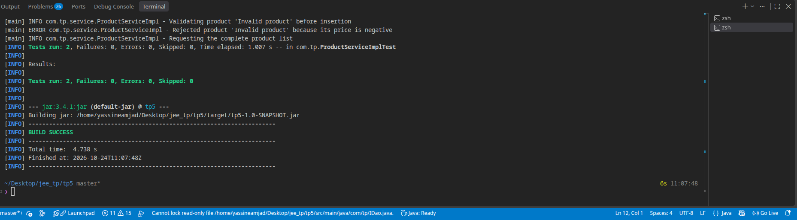

# TP5 - Spring, Hibernate et MySQL

Ce projet est un exemple minimal d'application Java utilisant Spring Framework,
Hibernate et MySQL pour enregistrer et lire des produits.

Les paramètres JDBC peuvent être remplacés par des variables d'environnement :
`DB_URL`, `DB_USERNAME`, `DB_PASSWORD` et `DB_DRIVER`.

## Organisation

- `MainApp` démarre et ferme le contexte Spring.
- `ProductServiceImpl` valide les produits et délimite les transactions.
- `ProductDaoImpl` exécute les opérations Hibernate.
- `HibernateConfig` configure la source de données et le `SessionFactory`.
- `TransactionConfig` enregistre le gestionnaire de transactions.

Toutes les sorties applicatives passent par SLF4J (`logger.info`, `logger.error`)
afin de conserver un format cohérent et de pouvoir changer l'implémentation de
logs sans modifier le code métier.

## Résultats obtenus dans ce TP

Après `mvn test`, les tests de validation du prix et de délégation DAO passent.
Après le démarrage de MySQL et l'exécution de `MainApp`, le résultat attendu
est l'insertion de `Microservice Gateway` puis l'affichage du nombre total de
produits en base dans les logs, par exemple :

```text
[main] INFO com.tp.MainApp - Starting the TP5 product application
[main] INFO com.tp.product.config.HibernateConfig - Creating the database connection for jdbc:mysql://localhost:3306/product_db
[main] INFO com.tp.service.ProductServiceImpl - Validating product 'Microservice Gateway' before insertion
[main] INFO com.tp.dao.ProductDaoImpl - Saving product 'Microservice Gateway'
[main] INFO com.tp.MainApp - Product added successfully; total products in database: 1
```

> Le total dépend du contenu déjà présent dans la base. Le projet ne promet
> donc pas que le nombre soit toujours égal à `1`.

## Exemple de traceback / erreur

Si MySQL n'est pas démarré, une erreur de connexion peut apparaître. Le
traceback ci-dessous est un exemple abrégé, destiné à documenter le cas :

```text
org.hibernate.exception.JDBCConnectionException: Unable to acquire JDBC Connection
    at org.hibernate.exception.internal.SQLExceptionTypeDelegate.convert(...)
Caused by: java.sql.SQLException: Communications link failure
    at com.mysql.cj.jdbc.ConnectionImpl.createNewIO(...)
```

Démarrer `docker compose up -d`, vérifier `docker compose ps`, puis relancer
l'application corrige généralement cette erreur.

## Emplacements des captures

